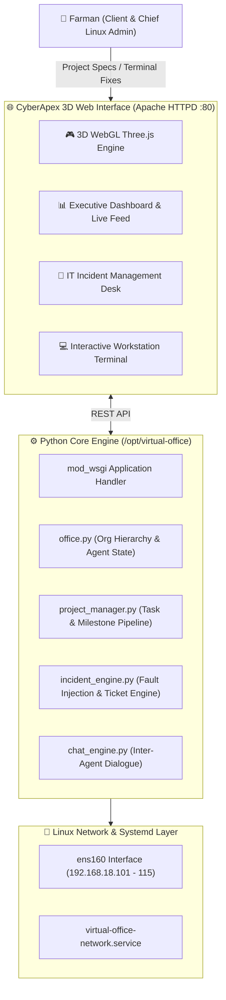

# 🏢 CyberApex — 3D Virtual Office & Autonomous AI Agent Linux Admin Simulator

[](https://www.python.org/)
[](https://httpd.apache.org/)
[](https://threejs.org/)
[](https://rockylinux.org/)

**CyberApex** is an interactive **3D WebGL Virtual Office RPG** and **Autonomous AI Agent Enterprise Simulator**. In this simulation, an enterprise team of 16 autonomous AI specialists (Engineering Managers, Tech Leads, Network Engineers, Full-Stack Developers, QA Leads, NOC Operators) collaborate in real-time within a virtual 3D office floor.

You take on a dual role:
1. **Client:** Issue real engineering projects, software goals, and feature deliverables to the Management team.
2. **Chief Linux Architect & System Administrator:** Resolve system-level failures, network drops, permission errors, and service crashes that agents encounter while building your projects.

---

## 🌟 Key Features

### 🎮 1. 3D WebGL Office Floor (Three.js)
- **Interactive 3D Workspace:** Isometric 3D view of 8 specialized cabins (Boardroom, NOC Room, DevOps War Room, Backend Bay, Frontend Studio, QA Lab, Cyber Lounge, Linux Command Deck).
- **Orbit & Preset Controls:** Full 360° orbit rotation, pan, zoom, and instant camera presets for each department.
- **Agent Raycasting:** Click on any 3D animated agent to open their live dossier, workstation details, current tasks, and remote shell.

### 🤖 2. Autonomous Multi-Agent Hierarchy & SOP Protocol
- **Specialized Workforce:** 16 distinct bot agents across Leadership, Infra, Network, QA, and Development.
- **4-Step SOP Execution:** Agents follow strict Standard Operating Procedures:
  1. *Requirement & Architecture Analysis*
  2. *Development & Provisioning*
  3. *Testing & Quality Assurance*
  4. *Production Deployment & Sign-off*
- **Enterprise Rules:** Zero-loss guarantees, non-destructive operation validation, and least privilege security.

### 🎫 3. Dynamic IT Helpdesk & Incident Generator
- Real-world Linux engineering issues trigger organically during agent tasks (e.g., MySQL socket lock, port conflicts, disk space exhaustion, DNS misconfigurations, rogue worker processes).
- Tickets include error traces, affected agent, workstation IP, and priority levels.

### 💻 4. Live Web Terminal & On-Demand Sandbox
- Isolated web terminal for each workstation IP (`192.168.18.101` – `192.168.18.115`).
- Runs real Linux commands on host or sandbox environments.
- **Resource Optimization:** Sandbox sessions dynamically spawn when troubleshooting starts and spin down when the ticket is marked resolved.

### 💬 5. Admin Remark & Verification Loop
- When resolving an incident, the Linux Admin enters technical remarks and resolution details.
- The reporting agent verifies the environment fix, replies to the admin's remarks, and resumes their workflow.

### 🌐 6. Native Apache HTTPD & Multi-IP Network Virtualization
- Deployed on **Apache `httpd` with `mod_wsgi`** on standard HTTP port 80.
- All 15 specialist workstations are bound as persistent secondary IP aliases on the physical interface (`ens160`) via a systemd unit (`virtual-office-network.service`), making them pingable and network-accessible.

---

## 🏗️ System Architecture



---

## 📂 Project Structure

```
/opt/virtual-office/
├── app.py                      # Flask Application entry point & API endpoints
├── virtual_office.wsgi         # Apache mod_wsgi gateway script
├── setup_network.sh            # Network alias binding script
├── engine/
│   ├── __init__.py
│   ├── office.py               # Enterprise organization, agent specs & states
│   ├── project_manager.py      # Project lifecycles, milestones, & SOP engine
│   ├── incident_engine.py      # Real & simulated system incident generator
│   └── chat_engine.py          # Multi-agent chat & dialogue simulation
├── sandbox/
│   └── rogue_worker.py         # Sandbox test processes for incident simulation
├── static/
│   ├── css/
│   │   └── office.css          # Futuristic glassmorphism UI styles
│   └── js/
│       ├── office3d.js         # Three.js 3D scene, models, lights, controls
│       └── app.js              # Live polling, ticketing, terminal & UI logic
├── templates/
│   └── index.html              # Main CyberApex 3D Dashboard template
└── deploy/
    ├── apache/
    │   └── virtual-office.conf # Apache VirtualHost & mod_wsgi configuration
    ├── systemd/
    │   └── virtual-office-network.service # Network IP persistence service
    └── scripts/
        └── virtual-office-network.sh      # Secondary IP binding script
```

---

## 🚀 Quick Setup & Deployment

### Prerequisites
* Rocky Linux 8/9, RHEL, CentOS Stream, or Fedora
* Python 3.9+ with `pip`
* Apache HTTP Server (`httpd`) and `python3-mod_wsgi`

### 1. Installation
```bash
# Clone the repository
git clone https://github.com/jacky1473/CyberApex.git /opt/virtual-office
cd /opt/virtual-office

# Install Python requirements
pip install flask
```

### 2. Network Configuration
```bash
# Copy and enable the persistent IP binding service
cp deploy/systemd/virtual-office-network.service /etc/systemd/system/
cp deploy/scripts/virtual-office-network.sh /usr/local/sbin/
chmod +x /usr/local/sbin/virtual-office-network.sh

systemctl daemon-reload
systemctl enable --now virtual-office-network.service
```

### 3. Apache HTTPD Setup
```bash
# Copy Apache configuration
cp deploy/apache/virtual-office.conf /etc/httpd/conf.d/

# Set appropriate permissions
chown -R farman:farman /opt/virtual-office
chmod -R 755 /opt/virtual-office

# Restart Apache
systemctl restart httpd
```

### 4. Access the Dashboard
Open your browser and navigate to:
```
http://localhost/
# or from another machine in your LAN:
http://<server-ip>/
```

---

## 👥 Agent Workforce

| Workstation IP | Specialist Name | Role | Department |
| :--- | :--- | :--- | :--- |
| `192.168.18.101` | **Aarav Sharma** | Chief Solutions Architect & Lead | Leadership |
| `192.168.18.102` | **Priya Patel** | Scrum Master & Agile Lead | Project Mgmt |
| `192.168.18.103` | **Vikram Malhotra**| Principal Network Architect | Network / NOC |
| `192.168.18.104` | **Sameer Khan** | NOC / Storage Engineer | Network / NOC |
| `192.168.18.105` | **Rohan Gupta** | Senior DevOps & CI/CD Lead | DevOps |
| `192.168.18.106` | **Kavita Desai** | Site Reliability Engineer (SRE) | DevOps |
| `192.168.18.107` | **Aditya Verma** | Lead Backend Engineer (Python/Go) | Backend |
| `192.168.18.108` | **Meera Iyer** | Database Administrator (DBA) | Backend |
| `192.168.18.109` | **Kunal Joshi** | Senior Microservices Specialist | Backend |
| `192.168.18.110` | **Neha Kapoor** | UI/UX & Frontend Architect | Frontend |
| `192.168.18.111` | **Rahul Singh** | React & WebGL Graphics Engineer | Frontend |
| `192.168.18.112` | **Tanvi Roy** | Mobile & Responsive Web Dev | Frontend |
| `192.168.18.113` | **Ananya Sen** | Quality Assurance (QA) Lead | QA & Testing |
| `192.168.18.114` | **Deepak Nair** | Performance & Security Tester | QA & Testing |
| `192.168.18.115` | **Farhan Siddiqui** | Cyber Security & SOC Analyst | InfoSec |

---

## 📄 License
This project is open-source and available under the [MIT License](LICENSE).
